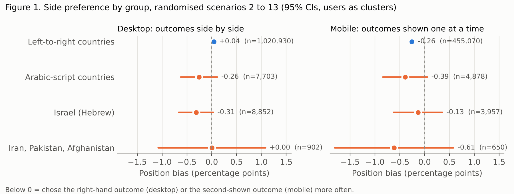
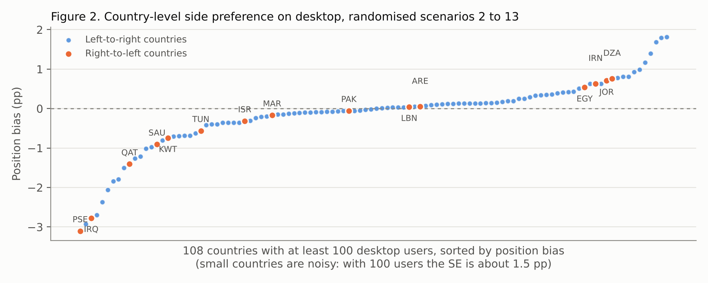

# Does reading direction push people toward the right-hand option? A pre-registered test in 10.8 million Moral Machine choices

[Author name] · Draft, 15 October 2026

## Abstract

People who read left to right show leftward biases in many perception and drawing tasks, and right-to-left readers often show weaker or reversed ones. I tested whether this carries over to a real choice between two pictures. I used the public Moral Machine data (Awad et al., 2018): 1.04 million desktop users picked one of two side-by-side outcomes of a self-driving-car dilemma, and the side each outcome appeared on was randomised. The hypotheses were pre-registered before the outcome was examined. In left-to-right countries, users picked the left outcome 50.04% of the time (95% CI 50.01 to 50.07), a bias of 0.04 percentage points. Users in Arabic-script countries picked it 49.76% of the time, and users in Israel, Iran, Pakistan and Afghanistan 49.72%. Neither pre-registered comparison with left-to-right countries was significant (Arabic: -0.32 pp, p = .09; other right-to-left: -0.29 pp, p = .09). An exploratory test pooling all 17,457 right-to-left users was significant (-0.31 pp, p = .014), and the gap did not appear on mobile, where the two outcomes are not shown side by side. In later sessions by the same returning users, both right-to-left groups again sat about 0.5 points below left-to-right users, and again the difference was not significant. Any effect of reading direction on side choice in this task is smaller than about 0.7 percentage points, under 1/70 of the age effect in the same data. I also found that the first scenario of every session always puts the "stay" outcome on the left, which inflates any naive left-right analysis of this dataset.

## Introduction

Reading direction shapes where people put things in space. Left-to-right (LTR) readers tend to draw the agent of an action on the left and to scan scenes from left to right, while Arabic readers often show the reverse, and Hebrew readers show weaker or mixed effects that are usually put down to heavy exposure to English (Maass & Russo, 2003; see the 2023 review in *Psychonomic Bulletin & Review*). Almost all of this evidence comes from drawing, description and perception tasks with small samples. I could not find a study that asks whether reading direction changes which of two options people pick when the options sit side by side.

The Moral Machine experiment makes that question cheap to test at scale. Each scenario shows two outcomes of a dilemma, one where an autonomous car stays on course and one where it swerves, and the user clicks the one the car should choose. The side each outcome appears on was randomised "to avoid any bias from handedness" (Awad et al., 2018, supplement). Because placement is random, the moral content of a scenario cannot produce a preference for one side. Any side preference is a pure position effect, and comparing it across countries with different scripts tests reading direction directly. The original authors checked only that the size of each moral preference was the same whichever side it appeared on. They did not report the overall rate of choosing the left option, or break it down by country.

I pre-registered three hypotheses. H1: desktop users in LTR countries pick the left outcome more than half the time. H2 (primary): users in Arabic-script countries pick the left outcome less often than LTR users. H3: users who read a right-to-left script natively but saw a left-to-right page, because Moral Machine had no Hebrew, Persian or Urdu version (Israel, Iran, Pakistan, Afghanistan), also pick the left outcome less often than LTR users.

## Method

### Data and sample

I used `SharedResponsesFullFirstSessions.csv` from the Moral Machine OSF project (osf.io/3hvt2), which holds each user's first completed session of 13 scenarios. Each scenario has two rows, one per outcome, with a randomised `LeftHand` flag and a `Saved` flag. The README states that the clicked outcome is the one whose characters die, and that `Saved` is reverse-coded from the click, so the clicked outcome is the row with `Saved = 0`. I kept scenarios with exactly two rows, one on each side and exactly one saved, giving 17.0 million decisions from 1.50 million users. Country comes from the user's IP address. The data does not record interface language.

Countries were grouped in advance. ARABIC holds 19 states where Arabic is the dominant script and the site was available in Arabic. RTL_OTHER holds Israel, Iran, Pakistan and Afghanistan. Five countries where Arabic is official but not the main literacy script were excluded (Comoros, Djibouti, Somalia, Eritrea, Chad), and LTR is every other country.

The confirmatory tests use desktop users only, because the desktop page shows the two outcomes side by side. On mobile the outcomes appear one at a time in a carousel, and `LeftHand` marks the outcome shown first. I checked the current site in a headless browser: the Arabic page is laid out right to left, but the two outcome pictures are not swapped, so `LeftHand = 1` is the left side of the screen in both languages.

### Deviations from the pre-registration

The pre-registered randomisation check failed. Across all scenarios, the stay outcome was on the left 53.9% of the time. Splitting by position in the session showed why: in scenario 1 the stay outcome was on the left in 100% of desktop cases (99.95% on mobile), and in scenarios 2 to 13 it was on the left between 49.9% and 50.1% of the time. Users prefer the stay outcome (LTR desktop users picked it 53.85% of the time), so scenario 1 adds a few points of fake left preference. The pre-registered tests below therefore use scenarios 2 to 13 only, leaving 10.8 million desktop decisions. Results on all 13 scenarios, and a second estimator that averages the left-click rate over stay-on-left and stay-on-right scenarios, are in the results folder. Both lead to the same conclusions. The pooled right-to-left test, the Israel-only split and the replication on later sessions were added after the pre-registration and are labelled exploratory. During data checks, before running the tests, I printed one pooled crosstab of `LeftHand` by `Saved` across all devices and countries, with no group breakdown.

### Analysis

For each user I computed the share of their scenarios in which they clicked the left outcome. H1 is a one-sample t-test of these user shares against .50. H2 and H3 are Welch t-tests of user shares, group against LTR. I also report the decision-level rate with standard errors clustered by user, and a country-level test that treats each country with at least 100 desktop users as one observation (Welch t-test and a 10,000-draw permutation test). H2 counted as supported only if the user-level test was significant at .05 and the country-level difference had the same sign.

## Results

Table 1 gives the left-click rates. Figure 1 shows the position bias with 95% confidence intervals, and Figure 2 shows every country with at least 100 desktop users.

Table 1. Share of decisions in which the user clicked the left (desktop) or first-shown (mobile) outcome, scenarios 2 to 13.

| Group | Desktop users | Desktop decisions | Desktop left rate (95% CI) | Mobile users | Mobile first-shown rate (95% CI) |
|---|---|---|---|---|---|
| LTR countries | 1,020,930 | 10,663,789 | 50.04% (50.01, 50.07) | 455,070 | 49.75% (49.71, 49.80) |
| Arabic-script countries | 7,703 | 80,245 | 49.76% (49.38, 50.13) | 4,878 | 49.60% (49.16, 50.05) |
| Israel, Iran, Pakistan, Afghanistan | 9,754 | 101,675 | 49.72% (49.39, 50.05) | 4,607 | 49.81% (49.35, 50.27) |

### Hypothesis tests

H1 was not supported. LTR desktop users clicked the left outcome in 50.04% of decisions. The mean of user shares was 50.00%, t(1,020,929) = -0.13, p = .90. With a million users the confidence interval is narrow enough to rule out any left bias larger than 0.07 percentage points.

H2 was not supported. Users in Arabic-script countries clicked left 0.32 points less often than LTR users, t(7,812) = -1.68, p = .093, d = -0.02. The decision-level difference was -0.29 points (SE 0.19, p = .13). At the country level, the 12 Arabic-script countries with at least 100 desktop users averaged 0.52 points below the 93 LTR countries (Welch p = .20, permutation p = .059). The direction matched the prediction in every version of the test, and none reached .05.

H3 was not supported. The RTL_OTHER group clicked left 0.29 points less often than LTR users, t(9,926) = -1.69, p = .090. Israel supplied 8,852 of its 9,754 users and sat at 49.69% (stay-balanced estimate, 95% CI 49.34 to 50.03). The 902 users in Iran, Pakistan and Afghanistan sat at 50.00%, with a confidence interval about two points wide.

### Mobile

On mobile, LTR users chose the second-shown outcome slightly more often (49.75% first-shown, p < .001), a 0.25-point recency effect. Neither right-to-left group differed from LTR users on mobile (Arabic: -0.14 points, p = .54; RTL_OTHER: +0.07 points, p = .77).

### Exploratory results

Pooling both right-to-left groups (17,457 desktop users) gave a stay-balanced rate of 49.73%, 0.31 points below LTR users (95% CI -0.56 to -0.06, p = .014; user-level Welch p = .009). The pooled country-level test was not significant (15 vs 93 countries, permutation p = .11). The Arabic-script gap appeared only in scenarios where the user did not open the text description (-0.60 points, p = .017) and not where they did (+0.15 points, p = .60). Among LTR users, the side preference drifted by -0.014 points per scenario across positions 2 to 13, a total change of under 0.2 points.

### Replication on later sessions (exploratory)

The all-sessions file (`SharedResponses.csv`) adds 7.9 million randomised desktop decisions that are not in anyone's first completed session. Scenario 1 is fixed there too, so I again used scenarios 2 to 13. This pool mixes two kinds of data. Decisions by returning users, whose first session is in the main sample, look like the main sample: 168,194 LTR desktop users picked left 50.14% of the time, and the rate stayed between 49.98% and 50.34% across scenario positions. The rest comes from users with no completed first session in the file. Their LTR users picked left 48.7% of the time in scenario 2, rising to 49.7% by scenario 13, and a block of 1,335 accounts with no country code averaged 82 decisions each and picked left 55% of the time, which looks automated, so I treat that part as unreliable.

Among returning users on desktop, Arabic-script users picked left 49.60% of the time, 0.55 points below LTR users (p = .22, 1,419 users). RTL_OTHER users picked left 49.59% of the time, 0.55 points below (p = .11, 1,743 users), and the pooled right-to-left gap was 0.53 points (p = .05). The direction and size match the main sample, but the samples are a fifth of the size and none of these tests is significant at .05. The full later-session pool, which includes the unreliable part, gives an Arabic gap of 0.89 points (p = .001); I do not count it as evidence. These are mostly the same people as the main sample making new choices, so this replication is not independent at the level of people. On mobile, the Arabic group again showed no gap (+0.06 points, p = .91), while the RTL_OTHER group, mostly Israel, showed a 0.93-point gap (p = .057). The Israeli mobile result does not fit a purely spatial account, since mobile users never saw the outcomes side by side.

## Discussion

Left-to-right readers showed no left bias in this task. The interval around their rate, 50.01% to 50.07%, comes from over ten million choices, and it rules out the kind of left preference that drawing and aesthetic studies report. The likely reason is that the two Moral Machine outcomes differ in content that people care about: in the same data, the preference for sparing younger characters changes the choice probability by 0.49 (Awad et al., 2018, supplement), and the preference for the stay outcome by about 0.04. A position effect has little room when the options differ that much.

Right-to-left users leaned slightly to the right in every desktop comparison, by 0.3 points in the main sample and about 0.5 points among returning users. Arabic-script users showed no such lean on mobile, which is what a spatial effect would predict, but Israeli users on mobile did in the later sessions, which it would not. The pre-registered tests were not significant, and the significant results come from tests I added afterwards. I read this as weak evidence for a very small effect, with the direction consistent across samples and the mechanism unclear. The upper ends of the confidence intervals give the useful conclusion: whatever reading direction does to side choice here, it is smaller than about 0.7 percentage points, under 1/70 of the age effect. Researchers who run two-option choice studies with right-to-left samples do not need to worry much about this bias if they randomise sides.

Three limits matter. Country is a proxy for script: the data does not record interface language, and expats, VPN users and Arabic-country users on the English site all push any effect toward zero. The check that the Arabic page is not mirrored was done on today's site and might not match 2016 to 2018. And the Moral Machine sample is self-selected, younger and more male than national populations (Awad et al., 2018).

The fixed first scenario is a practical finding for anyone using this dataset. Including scenario 1 raised the LTR left rate from 50.04% to 50.30% and moved the H2 p-value from .093 to .042, which would have counted as support for H2 under my own pre-registered rule. Analyses that use `LeftHand` should drop scenario 1 or balance on the stay outcome.

## References

Awad, E., Dsouza, S., Kim, R., Schulz, J., Henrich, J., Shariff, A., Bonnefon, J.-F., & Rahwan, I. (2018). The Moral Machine experiment. *Nature, 563*, 59 to 64. Data: osf.io/3hvt2.

Maass, A., & Russo, A. (2003). Directional bias in the mental representation of spatial events: Nature or culture? *Psychological Science, 14*(4), 296 to 301.

[Authors] (2023). Reading/writing direction as a source of directional bias in spatial cognition: Possible mechanisms and scope. *Psychonomic Bulletin & Review*. https://link.springer.com/article/10.3758/s13423-022-02239-1

## Materials

Pre-registration: `01_preregistration.md` (commit 0c86a42, made before analysis). Code: `prepare.py`, `analysis.py`, `analysis_adjusted.py`, `make_figures.py`. Outputs: `results/` (all 13 scenarios) and `results/randomised_2_13/` (reported here).

To reproduce: download `SharedResponsesFullFirstSessions.csv.tar.gz` from osf.io/3hvt2 (https://osf.io/download/ukmzd/), reduce it to Parquet with the columns used in `prepare.py`, then run `prepare.py`, keep `scenario_order` 2 to 13, and run `analysis.py`, `analysis_adjusted.py` and `make_figures.py` on the result. The replication uses `SharedResponses.csv.tar.gz` (https://osf.io/download/tdqrn/) minus the first-session scenarios. The raw data (about 8 GB uncompressed) is not stored in this repository.
