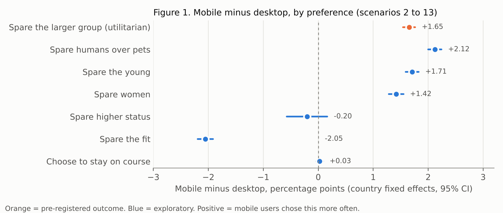
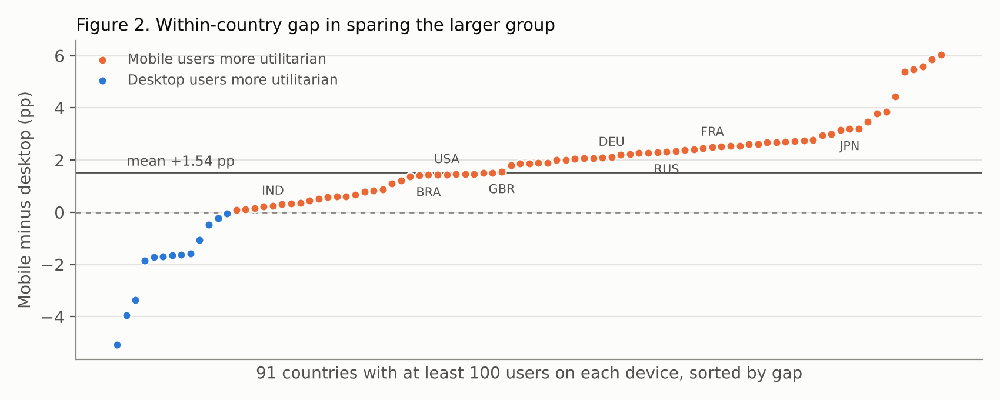

# Do smartphone users choose more utilitarian outcomes? A pre-registered test in 2.8 million Moral Machine dilemmas

[Author name] · Draft, 15 October 2026

## Abstract

A 2017 lab study found that people answering trolley dilemmas on a smartphone chose the utilitarian option more often than people on a PC (33.5% vs 22.3%). I tested the same idea on the public Moral Machine data (Awad et al., 2018), where 1.50 million people decided whose lives a self-driving car should spare and the site recorded whether they used a desktop or a phone. In 2.77 million dilemmas that pit a larger group against a smaller one, mobile users spared the larger group 78.70% of the time and desktop users 77.62%. Within the same country the gap was 1.54 percentage points (91 countries, t(90) = 7.52, p < .001), it was positive in 78 of the 91 countries, and it held after adjusting for age, gender, education, income, politics and religion (+1.34 points, p < .001). An equivalence test showed the gap is also reliably smaller than 2 points, about one seventh of the lab effect. Exploratory comparisons complicate the utilitarian reading: mobile users also spared humans over pets, the young over the old, and women over men more often, by similar amounts, while they spared fit characters over large ones less often. Phone users in this task show stronger preferences on most dimensions, of which sparing more lives is one.

## Introduction

Barque-Duran, Pothos, Hampton and Yearsley (2017) asked whether the device people use changes their moral judgments. In their first experiment (N = 1,010), 33.5% of smartphone users and 22.3% of PC users chose to sacrifice one person to save five in a high-conflict dilemma. They explained it through psychological distance and time pressure on phones. The effect did not appear in every one of their experiments, and the samples were small.

The Moral Machine experiment collected about 40 million decisions from people in 233 countries and territories (Awad et al., 2018). Each scenario shows two outcomes of an accident involving a self-driving car, and the user picks which group of characters the car spares. The site logged the device for every decision. Awad et al. checked only that the direction and order of each preference were the same on every device. I could not find any study that compared the size of moral preferences between phone and desktop users in this data.

I pre-registered three hypotheses. H1: within the same country, mobile users spare the larger group more often than desktop users. H2: the mobile advantage is larger when sparing the larger group requires the car to swerve, an action, than when it requires staying on course. H3: the H1 gap survives adjustment for demographics.

## Method

### Data

I used the first completed session of every user (`SharedResponsesFullFirstSessions.csv`, osf.io/3hvt2) and kept desktop and mobile decisions, dropping rows with no device recorded. Following the reading-direction study in this repository, I used scenarios 2 to 13 of each session, because scenario 1 has a fixed layout; the results with all 13 scenarios are reported as a sensitivity check.

The outcome comes from the "Utilitarian" scenarios, where one group is the other group plus one to four extra characters. `SavedMore` is 1 when the user spared the larger group. That gave 1,912,687 desktop decisions from 1,036,642 users and 856,850 mobile decisions from 464,257 users, about two utilitarian scenarios per user. For H2, `MoreNeedsSwerve` is 1 when the larger group dies if the car stays on course, so sparing it requires swerving. For H3, I used the survey file (`SharedResponsesSurvey.csv`), which holds the decisions of users who completed the optional demographic survey. I dropped users who left any question at its default, which left 345,852 decisions from 181,193 users.

Users picked their own device, so device was not randomised, and the two devices also show the dilemma differently: desktop shows the two outcomes side by side, while mobile shows one at a time in a swipeable carousel with "stay" and "swerve" buttons.

### Analysis

The pre-registered primary test of H1 compares devices within each country. For each of the 91 countries with at least 100 users on each device, I computed the mobile rate minus the desktop rate and ran a one-sample t-test of these 91 differences against 0. A supporting estimate came from a decision-level linear probability model with country fixed effects and standard errors clustered by user. H2 used the same within-country difference, computed separately for swerve-needed and stay-needed scenarios, and tested the difference between them. H3 added age, gender, education, income, and the political and religious sliders to the fixed-effects model. I pre-registered an equivalence test (two one-sided tests) with bounds of ±2 percentage points.

## Results

| Device | Users | Decisions | Spared the larger group | When sparing it needs a swerve | When sparing it needs staying |
|---|---|---|---|---|---|
| Desktop | 1,036,642 | 1,912,687 | 77.62% | 74.92% | 80.32% |
| Mobile | 464,257 | 856,850 | 78.70% | 76.44% | 80.96% |

Table 1. Share of utilitarian decisions in which the user spared the larger group, first sessions, scenarios 2 to 13.

### Hypothesis tests

H1 was supported. Within countries, mobile users spared the larger group 1.54 percentage points more often than desktop users (95% CI 1.13 to 1.94, t(90) = 7.52, p < .001). The gap was positive in 78 of 91 countries (Figure 2). The fixed-effects estimate was 1.65 points (95% CI 1.54 to 1.76). The raw gap without country adjustment was 1.09 points. Using all 13 scenarios gave a within-country gap of 1.31 points (p < .001).

The equivalence test showed that the gap is smaller than 2 points (90% CI 1.56 to 1.75, TOST p < .001). Phone users are more likely to spare the larger group, by a reliable but small margin, about one seventh of the 11-point difference in Barque-Duran et al. (2017).

H2 got mixed support. Pooled over users, the mobile gap was 1.52 points when sparing the larger group required swerving and 0.64 points when it required staying, and the fixed-effects interaction was 0.87 points (95% CI 0.66 to 1.08, p < .001). The pre-registered primary test, which weights the 91 countries equally, found a difference of only 0.23 points (t(90) = 0.52, p = .60). The pooled estimate weights every user equally, so large countries dominate it, and I do not count H2 as supported.

H3 was supported. In the survey subset the mobile gap was 1.48 points before adjustment and 1.34 points after adjusting for age, gender, education, income, politics and religion (95% CI 1.01 to 1.68, p < .001). Phone users in this subset were a little less often male (72% vs 78%) and about the same age (28.1 vs 28.0 years), and these differences explain only a tenth of the gap.

### Exploratory results

Figure 1 shows the same within-country comparison for the other Moral Machine preferences. Mobile users also spared humans over pets more often (+2.12 points), the young over the old (+1.71 points) and women over men (+1.42 points). They spared fit characters over large ones less often (-2.05 points), showed no difference for higher over lower social status (-0.20 points, p = .28), and chose to stay on course exactly as often as desktop users (+0.03 points, p = .39). All gaps other than status and staying had p < .001.

## Discussion

Phone users in the Moral Machine spared more lives than desktop users, in most countries and after adjusting for demographics. The direction matches Barque-Duran et al. (2017), but the size does not: 1.5 points here against 11 points in their footbridge dilemma. One reason may be that every Moral Machine dilemma is impersonal, since the car does the harm, while their effect was strongest in personal dilemmas where the participant pushes someone.

The exploratory results change how to read the main finding. If phones made people more utilitarian, the gap should be special to the number of lives, but phone users also had stronger preferences for sparing humans, children and women, by about the same amount. They did not differ on staying versus swerving, which is the action-versus-inaction part of the trolley problem, and their H2 interaction did not hold across countries. Phone users show stronger versions of the majority preferences on most dimensions, and the utilitarian gap is one case of that.

The two preferences that went the other way give a clue. Fitness (athletes vs large people) and social status (executives vs homeless people) are signalled by small details in the drawings, while number, species, age and gender are visible at a glance. On a small screen the subtle cues may be harder to see, which would weaken those two preferences and leave room for the obvious ones to dominate. This is an explanation I came up with after seeing the data, so it is a hypothesis for a new test, not a finding. Because the mobile interface differs from the desktop one, a lab study that holds the interface fixed and varies only screen size could test it.

The limits are the ones stated in the pre-registration. Device was self-selected. Country fixed effects and six demographics removed little of the gap, but phone and desktop users can still differ in ways the data does not record, such as how rushed they were. The device comparison is also an interface comparison, so this study cannot say whether the phone, the carousel layout or the buttons produced the gap, and the Moral Machine sample itself is self-selected, young and mostly male (Awad et al., 2018).

## References

Awad, E., Dsouza, S., Kim, R., Schulz, J., Henrich, J., Shariff, A., Bonnefon, J.-F., & Rahwan, I. (2018). The Moral Machine experiment. *Nature, 563*, 59 to 64. Data: osf.io/3hvt2.

Barque-Duran, A., Pothos, E. M., Hampton, J. A., & Yearsley, J. M. (2017). Contemporary morality: Moral judgments in digital contexts. *Computers in Human Behavior, 75*, 184 to 193. https://doi.org/10.1016/j.chb.2017.05.020

## Materials

Pre-registration: `01_preregistration.md` (commit e22f423, made before analysis). Code: `analysis_device.py` and `make_figures_device.py`; the first-session file is reduced to Parquet as in `../reading_direction_moral_machine/prepare.py`. Outputs: `results/results.json` and `results/country_diffs_*.csv`. The raw data is not stored in this repository; download it from osf.io/3hvt2.
